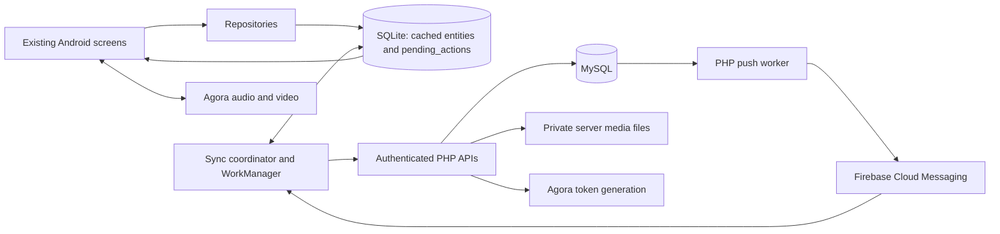

# Assignment 03: complete execution and verification plan

Prepared 18 November 2026 for `i230529_i230723` / `com.shadowdevelopers.i230529_i230723`.

Primary specification: `SMD_Assignment_03.pdf`, all three pages. Screen reference in this workspace: `Kinnect_UI (1).pdf`, 23 pages. Existing implementation and documentation were inspected to establish the migration baseline. This is a plan and source audit; existing runtime correctness, hosted security rules, repository visibility, and device compatibility have not been certified. No grade can be guaranteed; the objective is demonstrable coverage of every specified requirement.

## 1. What the assignment actually requires

The application must retain all 23 Kinnect screens and Assignment 2 behavior while replacing Firebase Authentication and Realtime Database with **your own PHP web services backed by MySQL**. Uploaded bytes must live on the **server filesystem**, with access through the APIs. Android must use **SQLite** for cached data and a durable `pending_actions` queue. Firebase is retained for **FCM only**; Agora remains the audio/video transport.

The printed allocations total **120 marks: 100 for the implementation categories and 20 for the live demo**. Do not assume how the instructor will normalize them. The PDF does not give a deadline; obtain the actual date, time, timezone, and portal instructions from the course announcement.

| Rubric item | Marks | Required deliverable and evidence |
|---|---:|---|
| GitHub version control | 10 | New private repository; real contributions from both original group members; meaningful separate feature commits for Android and backend, all before deadline |
| Splash | 5 | Visible for 5 seconds; locally valid stored session routes directly to Home offline; no token routes to Login |
| Authentication | 5 | PHP signup/login/logout; server password hashing; securely stored session token on authenticated requests; first-time profile setup; strength indicator; recent login; complete logout cleanup |
| Stories | 10 | Camera/gallery image and video upload; label; Your story/Close friends; metadata in MySQL, bytes in filesystem; server and SQLite 24-hour expiry; friends' horizontal row with Create story first |
| Posts, reactions, comments | 10 | Text and multiple image multipart posts; exact multi-image grid and +N; six changeable/removable reactions, one/user/post; replies, comment likes, image comments; own/friends feed newest first; SQLite cache |
| Messaging | 10 | Text, images, videos, generic files; MySQL storage and SQLite cache; own-message edit/delete under server-enforced 5-minute limit; Edited label; receive without leaving screen |
| Voice/video calls | 5 | Both chat icons launch functional Agora calls; server call logs |
| Friends/profiles | 5 | Send/confirm/delete requests through all four specified entry points; correct Add friend → Requested → Friends states; lists/pending requests; profile photo/cover/name/username/bio updates |
| Push | 5 | PHP stores per-device FCM tokens and sends notifications for messages, friend requests, chat screenshots |
| Search/filters | 5 | Server search by username or name while typing; Friends / Requests / Everyone filters |
| Presence | 5 | Online/offline changes without reopening screen; green dots and Active now |
| Security/privacy | 5 | Screenshot creates conversation system message and notification for the other participant |
| Offline SQLite | 15 | Messages/posts/stories/users/friends; local-first screens; immediate pending UI for offline actions; persistent ordered retries on reconnect; UUID deduplication on server |
| Espresso | 5 | Two critical-workflow Espresso tests that run against the migrated app |
| Live demo | 20 | Two devices; backend running; messaging/calls/presence/push; disconnect/actions/reconnect with no duplicates; both members present, explaining and modifying code live; no recorded-video substitute |

### Submission rules that can invalidate the submission

- [ ] Use the same two-person group as Assignment 2. One member submits for both.
- [ ] Create a **new private GitHub repository for Assignment 3**; confirm instructor access requirements separately.
- [ ] Keep project name `i230529_i230723` and package `com.shadowdevelopers.i230529_i230723`, assuming these are the two members' correct roll numbers. These existing names match the required pattern.
- [ ] Export with **Android Studio → File → Export → Export to ZIP File**.
- [ ] Name folder and ZIP `i230529_i230723_Assignment03` and `i230529_i230723_Assignment03.zip`.
- [ ] Include complete Android and PHP source, schema/migrations, setup instructions, and test instructions in the exported project. Inspect the actual export; do not assume the backend directory was included.
- [ ] Keep `google-services.json`, Agora App Certificate, service-account credentials, database passwords, `.env`, and live tokens out of public locations. Keep secrets out of the new repository as well; provide templates and a private setup procedure.
- [ ] Check the ZIP separately for credentials: a file being git-ignored does not prove Android Studio excluded it from the export.
- [ ] Do not fabricate, backdate, or assign each other commits. Both members make authentic commits under their own identities.
- [ ] Finish commits before the actual deadline. Do not rely on post-deadline corrections being accepted.

## 2. Current backend evaluation

### Findings from this codebase

| Area | Evidence | Assessment and required change |
|---|---|---|
| Backend architecture | `FirebaseData.kt` exposes RTDB references for users/profiles/friends/posts/comments/chats/calls/marketplace | Assignment 2 backend remains. No PHP or SQL implementation was found in the project. Build PHP/MySQL services rather than trying to rename the Firebase wrapper. |
| Migration coupling | A search for FirebaseAuth/FirebaseData/FirebaseDatabase found 241 matching lines across 49 production source files | Data access is spread across screens, helpers, models and services. Introduce repositories and database-independent models; migrate shared helpers and every caller. Changing one utility cannot finish the assignment. |
| Authentication | `LoginActivity.kt`, `SignupActivity.kt`, `Session.kt`, `MainActivity.kt` use FirebaseAuth | Replace identity, token handling, setup routing and logout. Firebase UID/session cannot remain the production auth mechanism. |
| Offline storage | No Room database, SQLite implementation, WorkManager sync, or `pending_actions` implementation was found | This is an unimplemented foundation, not a small cache improvement. In-memory `ProfileCache` and `MediaLoader` cache do not satisfy durable SQLite requirements. |
| Media | `MediaUploader.kt` encodes images/video/audio as base64 in RTDB; `MediaLoader.kt` uses `db:` references | Directly conflicts with filesystem requirement. Retain image compression, EXIF rotation and camera capture code; replace upload/storage/reference/loading mechanisms. |
| File messages | `ChatActivity.kt` media sending handles image/video plus a separate voice path; uploader supports image/video/audio | Generic file messages need a complete picker, upload, metadata, bubble, download and open flow. A picker using `*/*` does not by itself implement file messaging. |
| Story expiry | `Stories.kt` filters locally and has the owner's app remove expired rows on Home | Must move authoritative expiry to server query policy and enforce local expiry offline. Owner app cannot be responsible for global expiry. |
| Edit/delete rules | `ChatActivity.kt` checks time; `database.rules.json` also enforces owner and 300,000 ms | Preserve this useful server-side behavior in PHP. A disabled Android menu alone is insufficient. |
| Feed privacy | Posts are readable by signed-in users in `database.rules.json`; UI narrows feed | Enforce feed visibility and direct-resource access in PHP. UI filtering is not authorization. |
| Media privacy | `media/{id}` read rule permits any authenticated user | Apply chat membership/story audience/post visibility to API media delivery; random file IDs alone do not protect media. |
| Push transport | `PushQueue.kt` writes RTDB; `fcm-server/index.js` watches RTDB and looks up RTDB tokens | Replace with PHP-owned MySQL device registration and server-generated push jobs. Retain Android FCM reception and notification design after migration. |
| Push reliability | Node sender skips older-than-two-minute jobs and removes queue items in `finally`, including failures | Failed push requests can be lost. New sender needs durable retries, invalid-token cleanup, and deduplicated logical notification events. |
| Agora secrets | `app/build.gradle.kts` exposes configured certificate as BuildConfig; `AgoraToken.java` generates tokens on phone | A git-ignored certificate can still be extracted from an APK when configured. Move token generation and certificate to server; rotate if distributed/exposed. |
| Call signaling | `CallManager.kt` creates and observes RTDB callRequests/callLogs | Agora media can stay; migrate invitations, state changes, timeout handling and logs to PHP/MySQL. |
| Presence/background | `KinnectApplication.kt` uses RTDB `.info/connected` and `onDisconnect`; background service uses Firebase listeners | Replace with authenticated heartbeats, server TTL, foreground updates and FCM delivery. Persistent HTTP polling in a foreground service is not a substitute for the specified backend. |
| Search filters | `SearchActivity.kt` currently offers All/People/Posts/Groups/Marketplace | Add the specifically required Friends/Requests/Everyone relationship filters without breaking the existing visual language. |
| Logout | `Session.logout` marks offline, removes FCM token, stops listeners, Firebase signs out | Rewrite to revoke PHP session, unregister device, cancel user work, clear SQLite/media/user memory and back stack. Protect against old responses repopulating cache. |
| Backup/security | Manifest enables backup; backup XML files are largely templates | Explicitly exclude credentials and user caches from backup/transfer as appropriate; prevent restored stale sessions or another account's data. |
| Tests | `BackendWorkflowTest.kt` contains two genuine UI workflows, but imports FirebaseAuth and assumes RTDB | Rework login/setup/cleanup and assertions for PHP/SQLite; add offline failure scenarios to verification. Placeholder example tests are not workflow evidence. |
| UI | All 23 named screens have corresponding layouts/activities | Reuse as the baseline. File existence is not proof of pixel accuracy or working data binding. |
| Evidence | README says features compile and need device testing; `docs/TEST_MATRIX.md` lists NOT RUN | Do not claim runtime readiness or a current percentage score. Replace unverified documentation with dated results during implementation. |
| Git | Local history includes both Muhammad Moiz and Abdul Sami; origin points to `New_SMD_Assignment` | Helpful existing collaboration, but new private Assignment 3 repository and feature history are still required. Visibility of the remote was not verified. |

**Reuse:** XML layouts, navigation, adapters after decoupling, visual assets, CameraX, image processing, password-strength logic, screenshot detection, Agora rendering/audio controls, and FCM display code.

**Replace:** Firebase Auth/RTDB reads and writes, DataSnapshot-based model constructors, database listeners/transactions, base64 media storage, client-created notification jobs, client Agora signing, and Firebase-dependent test setup.

**Add:** PHP services; MySQL schema, migrations and indexes; secure sessions; filesystem uploads; SQLite repositories; durable action queue; idempotency receipts; change tracking/tombstones; reconnect sync; PHP FCM worker; deployment/seeding; real verification evidence.

### Audit limits and decisions to settle early

- The hosted Firebase deployment and real accounts were not accessed. Findings about rules refer to the checked-in rules file.
- Existing build artifacts do not prove this revision builds; perform a clean baseline build with private configuration before changing code.
- Existing UI documentation is inconsistent: its camera row describes an older system-camera implementation while production source/README describe CameraX. Refresh docs from the current app.
- Room is a SQLite abstraction and is technically suitable. If the course explicitly demands handwritten SQLiteOpenHelper/raw SQL, use that instead; isolate database access behind DAOs either way. The PDF says SQLite, not a required library.
- The PDF's offline valid-token → Home rule and first-time-profile → Edit profile rule need a consistent interpretation. Recommended: completed accounts route Home offline after 5 seconds; incomplete accounts resume setup; only missing/locally expired credentials go Login. Document this precedence and confirm with instructor if graded literally.
- Offline logout cannot immediately reach a server. Implement local logout immediately with a durable revocation-only job outside the cleared content cache; finish revocation when reachable, and explain the network limitation. Demonstrate the online logout path as well.
- Offline edits can expire before reconnect. Preserve the queued attempt, but the server must reject it after the 5-minute limit and the UI must explain the rejection. Do not weaken the server rule to make every offline action succeed.
- Existing Assignment 2 extras remain in scope under “Every screen must keep working exactly as in Assignment 2.” Inventory them; migrate their data or get explicit instructor scope guidance. New unrelated features should not displace rubric work.

## 3. Target architecture and conventions



Screen data comes from SQLite. Network reads update SQLite, which updates the screen. User writes update SQLite and insert a pending action in the same transaction. The sync coordinator submits that action to PHP and merges the canonical response back into SQLite.

Choose a modest stack: PHP with PDO and Composer, MySQL/InnoDB/utf8mb4, Apache or Nginx, persistent upload directory, a PHP CLI push worker, Kotlin API client (Retrofit/OkHttp or equivalent), Room/SQLite, and WorkManager. Reuse existing Activities; a Compose rewrite or microservice system adds no rubric value. Pin compatible dependency versions after checking the existing Gradle toolchain; do not combine the backend migration with unrelated upgrades.

Use opaque server session tokens rather than a complex JWT refresh system unless there is a demonstrated need. Recommended token: 32 random bytes encoded for transport, hashed in MySQL; Android stores the original securely. Authenticate using `Authorization: Bearer …`, and derive the acting user from the session on the server.

API contract decisions to freeze before feature work:

- Versioned base URL such as `/api/v1/`; `.php` endpoints are acceptable. Endpoint names below are a proposed contract, not extra PDF mandates.
- JSON metadata; multipart for uploads; UTC timestamps with one documented precision and representation.
- UUIDs for pending action IDs and preferably content IDs too. Distinguish `action_id` from `entity_id`: editing a message needs a new action UUID for the same message UUID.
- Explicit error codes and HTTP responses: 400 validation, 401 invalid session, 403 denied, 404 unavailable, 409 conflict, 413 too large, 415 unsupported type, 429 throttled, 5xx transient server failure.
- Standard success/error envelope, `server_time`, request correlation ID, optional pagination/change cursor. No PHP warnings or HTML before JSON.
- Stable pagination: feed `(created_at, id)` and message/change sequence cursors. A same-timestamp tie must never skip rows.
- Server ownership, membership, audience and time validation for every endpoint, including downloads.
- Request timeouts and bounded retries; API credentials and tokens excluded from logs.
- Explicit entity versions and tombstones for edits/deletes; server clock is authoritative for expiry/edit deadlines.
- Mutating business requests carry an action UUID. If the same UUID is reused with a different normalized payload, return a conflict.

Android's official guidance supports local-first storage and persistent write draining with WorkManager; use it as the architecture reference, while treating the assignment's queue guarantees as additional requirements. [Android offline-first data layer](https://developer.android.com/topic/architecture/data-layer/offline-first).

## 4. MySQL schema to implement

Use migrations, foreign keys, transactions, UTC server time, and explicit indexes. This is a proposed normalized design; equivalent schemas are fine if the invariants and access rules hold.

| Tables | Essential columns and invariants |
|---|---|
| `users` | UUID/id, normalized unique email, password_hash, display_name, unique normalized username, bio, profile/cover media IDs, profile_setup_complete, created_at, updated_at, version; allow username to be unset until setup |
| `sessions` | id, user_id, unique token_hash, device_id, issued_at, expires_at, revoked_at; token lookup index; never plaintext passwords |
| `devices` | user_id, installation/device_id, FCM token, enabled, updated_at, last_seen_at; token uniqueness and account reassignment rules |
| `friend_requests` | id, sender_id, receiver_id, state, created_at/updated_at; prevent self-request, duplicate active requests and inconsistent crossed requests |
| `friendships` | canonical ordered user pair, created_at; unique pair, query indexes for each user side; atomic acceptance/removal |
| `close_friends` | owner_id, member_id; composite unique; owner controls membership |
| `media` | id, owner_id, storage_path, MIME, original_name, byte_size, checksum, thumbnail_id/path, status, created_at; no uploaded binary/base64 column |
| `posts`, `post_media` | post id/author/body/style/created_at/updated_at/deleted_at/version; media association with stable position; require text or media |
| `post_reactions` | post_id, user_id, reaction enum; UNIQUE(post_id,user_id); exactly six permitted values |
| `comments`, `comment_likes` | comment id/post/author/parent/body/optional media/version/timestamps/deleted_at; same-post parent validation; UNIQUE(comment_id,user_id) likes |
| `stories` | id, owner_id, media_id, label, audience, created_at, expires_at, deleted_at, version; expiry computed server-side |
| `story_views`, `story_reactions` | story/viewer unique records; access requires live story audience; support existing viewer/reaction UI |
| `chats`, `chat_members` | unique canonical direct-user pair; member records; last-message reference; last-read sequence; no client-created arbitrary members |
| `messages`, `message_attachments` | message id/chat/sender/type/body/reply_to/server sequence/created_at/edited_at/deleted_at/version; attachments point to media and retain file names/types/sizes |
| `message_reactions`, `typing_states` | existing hearts and typing; member ownership; typing expiry so crashes do not leave permanent dots |
| `calls`, optional `call_events` | call UUID/chat/caller/callee/type/state/channel/created_at/accepted_at/ended_at; server-derived duration; valid state transitions |
| `presence_sessions` | user/device/session, foreground/online intent, last_heartbeat, expires_at; aggregate active sessions for multi-device users |
| `notifications` | id, recipient, actor, type, resource id, read_at, created_at; durable in-app notification independent of FCM |
| `push_jobs`, `push_deliveries` | logical event id, recipient/device, payload, attempts, next_attempt_at, status, last_error; unique event/device job; lease recovery |
| `processed_actions` | actor_id, action_uuid, operation, normalized request hash, response/status/entity mapping, committed_at; UNIQUE(actor_id,action_uuid) |
| `change_events` | committed monotonic cursor or equivalent safe cursor, recipient/scope, entity/type/id/version, deletion flag; records changes needed by clients |
| Existing extra-feature tables | marketplace items/media; groups/members/messages; notes; saved posts/highlights/events and other actually connected extras |

Required indexes: feed author/time/id; friendship both directions; request receiver/state; message chat/sequence; story owner/audience/expiry; notification recipient/time; session token hash; pending push due time/status; change recipient/cursor. Verify with query plans on seeded data; avoid fetching an entire social database for each screen.

Important database rules:

- Feed includes current user and accepted friends only. Authorize direct post/comment/media access consistently.
- Story reads always enforce `expires_at > server_now` and current audience. Cleanup is a separate maintenance task, not the visibility mechanism.
- Edits/deletes require original message sender and `server_now < created_at + 300 seconds`; agree and test the exact boundary. Client timestamps cannot extend it.
- One request acceptance atomically closes the request, creates friendship, creates notification/change event, and records the action receipt.
- Reaction/like endpoints express desired state, such as “set Love” or “remove”, rather than non-idempotent toggle semantics.
- API operations validate that attached media belongs to the actor and is suitable for the resource; do not accept another person's guessed upload ID.
- A message delete produces a tombstone/change event so cached copies on the other device disappear or show the agreed deletion placeholder.

Use PDO parameter binding, not string-concatenated SQL. Server hashing should use PHP's password APIs. [PDO prepared statements](https://www.php.net/manual/en/pdo.prepare.php), [password_hash](https://www.php.net/manual/en/function.password-hash.php), [password_verify](https://www.php.net/manual/en/function.password-verify.php).

## 5. PHP API inventory

Implement shared bootstrap, configuration, PDO connection, authentication middleware, validation, JSON responses, authorization helpers, transaction/idempotency service, upload service, and push-job service before duplicating logic across endpoints.

| Area | Proposed operations | Mandatory checks/results |
|---|---|---|
| Auth | `auth/signup.php`, `login.php`, `logout.php`, `me.php` | Hash/verify passwords, issue/revoke session, expiry, normalized duplicate identity errors, profile completion state; throttle login |
| Profile | `profiles/get.php`, `update.php`, `username-available.php` | Atomic uniqueness on actual save; name/username/bio; picture/cover references; availability check is advisory |
| Media | `media/upload.php`, `get.php`, `thumbnail.php` | Authenticated multipart, validated type/size, ownership and resource authorization, filesystem storage, MIME/length headers; playable video seeking/range support where needed |
| Friends | `friends/list.php`, `requests.php`, `send.php`, `accept.php`, `decline.php`, `cancel.php`, `remove.php` | No self-request, actor permission, crossed-request policy, canonical relationship state returned |
| Close friends | `close-friends/list.php`, `set.php` | Owner-managed membership; persist and cache |
| Feed/posts | `posts/feed.php`, `get.php`, `create.php` | Own/friends scope, newest first, ordered image list; `create.php` supports text and multiple uploaded image parts |
| Reactions | `posts/reaction-set.php`, `reaction-remove.php`, `reactions.php` | Six values, unique user/post; transactional count consistency |
| Comments | `comments/list.php`, `create.php`, `like-set.php`, `like-remove.php` | Text/image/replies; same-post parent; authorized post; ordered paging |
| Stories | `stories/feed.php`, `create.php`, `view.php`, `react.php`, `viewers.php`, `delete.php` | Filesystem media, label/audience, server 24h lifetime, close-friend checks, owner/viewer authorization |
| Chats/messages | `chats/list.php`, `ensure.php`, `messages/list.php`, `send.php`, `edit.php`, `delete.php`, `read.php`, optional `react.php`, `typing.php` | Membership, text/image/video/file support; five-minute sender rule; Edited label; preview/unread consistency |
| Search | `search/users.php?q=…&filter=friends|requests|everyone` | Server filters and name/username matching; bounded results, pagination, case normalization |
| Presence | `presence/heartbeat.php`, `set-offline.php`, `batch.php` | Session-bound updates, TTL expiration, multi-device aggregate, server last-seen |
| Screenshot | `chats/screenshot.php` | Member actor; server builds system-message text from actual profile; one action → system message + in-app notification + push job |
| Devices/notifications | `devices/register.php`, `unregister.php`, `notifications/list.php`, `read.php` | User/device token binding, logout removal, safe notification routing |
| Calls | `calls/start.php`, `accept.php`, `decline.php`, `cancel.php`, `end.php`, `events.php`, `history.php`, `token.php` | Participants only, legal state transitions, unique logs, short-lived channel/user-bound Agora tokens |
| Sync | `sync/changes.php?cursor=…`, optional `actions/status.php` | Authorized deltas/tombstones, safe pagination/cursor persistence, stable replay responses |
| Existing extras | marketplace/groups/notes/saved/events/highlights/live session metadata | Preserve actual existing connected functionality; FCM/Agora may transport alerts/media, but app data goes through PHP |
| Operational | `health.php`; CLI migrations, seed, expire-stories, push-worker | Health does not expose secrets; privileged reset/seed commands are never public unauthenticated endpoints |

Multipart strategy: keep a real `posts/create.php` multipart flow to satisfy the post wording. For generic media upload and offline attachments, reusable `media/upload.php` is useful. Assign stable upload UUIDs and stable part IDs; retries must return the same media IDs. A post create receipt must prevent another set of files being created when replayed. Separate uploaded-but-unattached files are cleaned after a grace period.

## 6. SQLite and offline synchronization: implement this before feature migration

### Local tables

Cache users, friends, friend requests, close-friend membership, posts, post-media associations, reactions, comments/likes, stories/views, chats/members/messages/attachments, call history, notifications and relevant extra-screen data. Include account ownership, server versions, updated/deleted timestamps and sync status. Keep media bytes in account-scoped local files, with metadata and file paths in SQLite; large files do not need to become SQLite blobs.

Add:

- `pending_actions`: ordered durable operations.
- `local_media`: upload/download UUIDs, file paths, MIME/name/size, upload progress/status, remote media mapping, cache availability.
- `sync_state`: current account, per-scope/page cursors, latest server time anchor, bootstrap state.
- `entity_id_map` only if server entity IDs differ from client IDs; using common UUIDs avoids much of this complexity.
- A separate narrowly scoped session-revocation store if supporting logout while offline. It must not preserve the cleared social-content cache.

Recommended `pending_actions` columns:

```text
sequence INTEGER PRIMARY KEY AUTOINCREMENT
action_uuid TEXT UNIQUE NOT NULL
account_id TEXT NOT NULL
operation TEXT NOT NULL
entity_id TEXT
payload_json TEXT NOT NULL
depends_on_action_uuid TEXT
state TEXT NOT NULL             -- queued, in_flight, retry_wait, blocked, failed
created_at_local INTEGER NOT NULL
attempt_count INTEGER NOT NULL DEFAULT 0
next_attempt_at INTEGER
lease_until INTEGER
last_error_code TEXT
last_error_message TEXT
```

Use a join table if an action needs multiple dependencies. Payloads reference persisted local files rather than temporary picker URIs or raw base64. Account-scoped tables/files/work names prevent cross-account leakage.

### Write path: one durable action from tap to acknowledgment

1. Validate immediate local input and session identity. Generate the entity UUID once for a new entity and a separate action UUID once for this operation.
2. For attachments, copy selected bytes to an app-owned persistent directory before accepting the action. Complete the copy safely, verify it, then record its path; clean abandoned staging files later. Temporary camera/cache files and picker permissions can disappear after a restart.
3. In **one SQLite transaction**, insert/update the optimistic entity, mark it pending, and insert its action. If this transaction fails, do not show success or clear the composer as if the action were saved.
4. UI observes SQLite and immediately renders the new item/change with a subtle Pending state in Kinnect styles.
5. Schedule uniquely named account sync work with a network constraint. When the app is active and internet becomes reachable, request a prompt drain through the same coordinator. Connectivity is a hint; only a successful API call proves the backend is reachable.
6. A single drainer claims the earliest eligible action using a database lease/transaction. Foreground and WorkManager execution share this lock; they must not submit independent unordered queues.
7. Upload required stable media parts or submit the multipart request. Preserve upload receipts across retries; do not regenerate action/upload UUIDs.
8. Send bearer token, action UUID, operation and payload. PHP verifies the actor and checks its action receipt.
9. On success, atomically merge canonical server fields/versions/timestamps, clear pending state for that acknowledged action, record mappings, and remove/acknowledge the queue row locally.
10. If the app dies before local acknowledgment, it submits the same action UUID again. PHP returns the original result, and the local merge remains an upsert rather than a duplicate insert.
11. Pull server changes for this user, store each page and its cursor together in a SQLite transaction, and let database observers update active screens.

Example: offline create post P, react to P, and comment on P must sync create P before dependent reaction/comment. Offline send M then edit M must not issue edit before send. Acknowledging M's creation must not overwrite a later local pending edit of M.

### Server deduplication transaction

For a business mutation, authorize the session, establish the actor/UUID unique receipt, validate normalized request hash, apply domain changes, insert change events and logical notification/push jobs, and store the replayable result in **one MySQL transaction**. Concurrent requests with the same UUID must serialize through the unique constraint/transaction, not a race-prone “SELECT then INSERT” check. On rollback no success receipt is retained. A retry after a lost response returns the committed receipt.

Filesystem writes cannot join a MySQL transaction. Stage validated uploads, assign stable media IDs/paths, publish through a tracked media status, and recover/clean uncommitted staged files. Do not expose a successful post pointing at missing bytes. Test a crash during upload and a crash between file move and database commit.

Do not advertise mathematically exactly-once networking. The target is **at-least-once delivery with one committed logical mutation per action UUID**, plus local upserts. Retain deduplication receipts for the maximum supported retry/offline lifetime; deleting them early can recreate old actions.

### Queue ordering and error policy

| Outcome | Required behavior |
|---|---|
| Timeout, DNS failure, disconnect, HTTP 5xx | Keep action and local files; back off with jitter; retry the same UUID; preserve order |
| HTTP 429 | Respect Retry-After, retain action |
| HTTP 401 | Pause user sync, retain unsent content, request authentication; resume only for the same account |
| Permanent validation/permission failure | Mark action failed with clear reason; preserve recoverable text/media; do not retry forever |
| Conflict/version mismatch | Fetch canonical state, retain the user's attempted change, show an actionable conflict; do not silently discard |
| Expired edit/delete | Server rejects; restore/merge canonical message, show explanation, preserve attempted text if useful |
| Dependency permanently failed | Mark dependent actions blocked; allow explicit retry/cancel/revise; do not send invalid references |
| App/process restarts | Reclaim expired in-flight lease and resume safely |
| User logs out or account changes | Cancel that account's work; prevent stale callbacks writing to another account's cache |

Default to strict queue sequence for the assignment. A transient failure pauses subsequent actions. A permanent failed action is explicitly resolved/marked terminal and its dependents blocked before independent later actions continue. This preserves defined order without one invalid request permanently stopping the app. Do not silently coalesce or reorder actions to optimize traffic until correctness is proven.

### Merge and download rules

- Server refresh cannot blindly replace an entity with newer unsent local changes. Keep canonical and pending state separately or replay pending operations over the canonical row.
- Apply changes by entity version and stable ID. Old poll results must not resurrect a deleted message or overwrite a newer edit.
- Keep deletion tombstones long enough for offline clients. If cursor retention expires, return a “full refresh required” response and rebuild cached server state while preserving pending local work.
- Change cursor creation must respect commit order. An auto-increment event ID allocated in a transaction can commit after a later ID; advancing past it can lose data. Use serialized committed event publication or an equivalent safe cursor scheme and test concurrent transactions.
- Pagination only replaces the relevant fetched page/scope. Absence from one page is not proof an item was deleted.
- Reconcile changes in friendships/audience permissions so inaccessible content is removed from local views/cache on the next successful sync. Data already cached on an offline device cannot be remotely erased before it reconnects.
- Persist enough thumbnails/media for the promised offline browsing. An image URL in SQLite does not make the image available offline. Keep downloaded files referenced by cached entities; show truthful unavailable states for files never downloaded.
- Purge expired stories locally on app start, resume, sync, and while an expiry deadline passes in an open screen. Retain a server-time anchor and elapsed-time basis where practical so ordinary clock changes do not extend stories.
- Complete feed/chat bootstrap and media caching before the demo goes offline. Test cold start offline, not just remaining on an already rendered screen.
- Do not schedule realtime messaging or presence only as periodic WorkManager jobs. Use lifecycle-bound polling/change fetch while active; WorkManager handles persistent recovery. Android does not promise immediate execution for every WorkManager job. [Android persistent work guidance](https://developer.android.com/develop/background-work/background-tasks/persistent).

### Offline acceptance gate

Before migrating the whole UI, prove one complete vertical workflow: PHP login → SQLite friends/chat → offline send → optimistic pending bubble → app restart → reconnect → one server message → one message on device B → same UUID replay still one message. Then prove create/edit/delete dependencies and a queued multipart post. If this foundation fails, pause feature expansion and fix it.

## 7. Feature implementation checklists

### 7.1 Authentication, splash and logout

- [ ] PHP validates signup, normalized email uniqueness and password policy, and hashes passwords with `password_hash`; login uses `password_verify`.
- [ ] Login/signup return authenticated user, completion status, session expiry and token. Use generic credential errors and bounded login attempts.
- [ ] Store bearer token using Android Keystore-backed encryption; never put passwords in the recent-login card or SQLite.
- [ ] Attach the token automatically to authenticated API requests and protected media requests. Handle expiry consistently.
- [ ] PDF names EncryptedSharedPreferences as an example. Its API is now deprecated; either document a compatible coursework choice or use direct Keystore-backed encryption. Plain preferences alone do not encrypt a token. Exclude encrypted credentials from backups. [Android API reference](https://developer.android.com/reference/androidx/security/crypto/EncryptedSharedPreferences), [Android crypto reference](https://developer.android.com/reference/kotlin/androidx/security/crypto/package-summary).
- [ ] Preserve the live password-strength meter and recent-login card behavior, including remove-card action and correct account image/name.
- [ ] New account goes to Edit profile for unique username and bio before Home. Server enforces uniqueness atomically, including two simultaneous saves.
- [ ] Splash waits five seconds without a network dependency; survives rotation/backgrounding without duplicate navigation; uses cached session/profile state.
- [ ] Logout online revokes token, marks this session offline, unregisters its FCM token, stops pollers/calls as appropriate, cancels sync, clears SQLite and account media/memory, removes secure token, and clears activity back stack.
- [ ] Define treatment of pending changes at explicit logout: warn that clearing the assignment-mandated cache discards unsynced actions, allow cancel/logout choice, and never silently report those actions as synced.
- [ ] Preserve optional recent-login metadata deliberately while clearing account content. Test login as B after logout as A: no A messages/images/posts appear.
- [ ] Preserve existing Forgot password behavior through an own-backend reset flow if keeping it functional. Use expiring, single-use reset tokens and a configured delivery channel; do not leave Firebase Auth behind for reset only. This is retained behavior, not a separately marked Assignment 3 item.

### 7.2 Profiles, friends and search

- [ ] Profile update supports picture, cover, name, username and bio, with upload progress and pending/error states.
- [ ] First-time setup enforces required fields on server; subsequent edits update all dependent avatars/names through SQLite.
- [ ] Implement outgoing request, cancellation, incoming confirm/delete, unfriend, pending list and friend list.
- [ ] Expose identical relationship state/actions in Search, Other profile, Friends, and Notifications; one repository maps server states to UI.
- [ ] Handle self-profile, duplicate request, crossed requests, acceptance replay, deleted requests and stale notification actions gracefully.
- [ ] Implement server search on username/display name, debounce around existing 250 ms, cancel/ignore stale responses, paginate and deduplicate.
- [ ] Add Friends / Requests / Everyone controls. Define Requests as incoming and outgoing pending requests, visibly distinguish them, and document that interpretation.
- [ ] Search cached users offline and label that scope honestly; do not claim a global offline search can find users never cached.
- [ ] Keep mutual friends/counts, close-friend management and existing profile photo grids working.

### 7.3 Posts, reactions and comments

- [ ] Multipart text + one/multiple images; preserve selected-image order, EXIF orientation and pending local previews.
- [ ] Post permission/visibility enforced on feed and individual resource endpoints.
- [ ] Feed own + accepted friends, newest first, stable pagination; load cached first without a network spinner blocking content.
- [ ] Match grid for 1, 2, 3, 4, 6+ images and exact +N count; image viewer opens correct image/order.
- [ ] Six reactions use current assets; set/change/remove is one reaction per user per post under concurrency and replay.
- [ ] Reactions/counts remain correct after local optimistic update and server merge.
- [ ] Comments support text, image, parent/replies, comment likes, thread expansion and correct author info.
- [ ] Offline post/reaction/comment/like shows immediate pending state; queued reply references parent action safely.
- [ ] Preserve existing share/save/style/tag/feeling/check-in/event flows where actually implemented; all data paths migrate off RTDB.

### 7.4 Stories and media

- [ ] Camera photo/video and gallery selection reach Story editor; text label and audience survive rotation/retry.
- [ ] Your story and Close friends use server-authorized audience lists, not client-only hiding.
- [ ] Server stores metadata in MySQL and files under controlled upload directory; story lifetime starts at server publication, not an untrusted offline client clock.
- [ ] Server never returns expired stories; local SQLite hides and removes expired records; server maintenance removes unreferenced files later.
- [ ] Home Create story stays first; friends' active stories follow; viewer progress, seen status, Your story viewers/reactions remain functional.
- [ ] Persist pending story media before queueing. Clearly distinguish a pending offline story from a published story.
- [ ] Use thumbnails for videos; store thumbnail URL/media ID explicitly instead of guessing a `.jpg` URL from a video extension.
- [ ] Filesystem upload security: validate upload errors, max sizes, actual MIME with file inspection, safe random filenames, extension allowlist, non-executable storage, no user-controlled paths, no directory listing. Set PHP/web-server limits consistently. [PHP upload primitive](https://www.php.net/manual/en/function.move-uploaded-file.php).
- [ ] Protected chat/close-friend media require authorization at delivery time. Prevent a public static URL from bypassing it. Ensure Glide/video/file download paths can authenticate.
- [ ] Generic files retain original name, MIME and size; download safely and open with FileProvider/URI permissions using a suitable installed app.

### 7.5 Messaging and live updates

- [ ] Conversation creation is unique for a user pair and cannot admit arbitrary third parties.
- [ ] Send/receive text, images, videos and files; retain existing voice messages, shared-post cards, replies and hearts where functional.
- [ ] Chats list has correct last-message preview/time, unread/read state and active users. Edits/deletes update previews consistently.
- [ ] Poll active chat for changes at a proposed 1–2 second interval; use deltas, avoid overlapping requests, stop when backgrounded. This is an implementation target, not a PDF latency number.
- [ ] Application-wide changes/FCM trigger SQLite refresh so lists and badges update. FCM is a signal; fetch authorized server data rather than treating notification payload as the full database.
- [ ] Editing/deleting own messages uses server creation time and a strict 5-minute check. Deny other users, changing original sender/time, and old-message edits even if the client UI is bypassed.
- [ ] “Edited” appears after successful edit and persists after restart. Pending edit/delete is visibly pending; rejected edits recover correctly.
- [ ] Handle message tombstones, unread counts, read cursors, paginated history and scroll position. New message should not force a user reading older content to the bottom unexpectedly.
- [ ] Typing/read receipts expire/update via APIs if preserving them; no hidden Firebase listener remains.

### 7.6 Presence, screenshot events and FCM

- [ ] Send authenticated foreground heartbeat, proposed every 15–20 seconds; derive online from an unexpired server lease, proposed 45–60 seconds. Tune and document demo latency; the PDF does not specify seconds.
- [ ] Explicit background/logout/disconnect intent updates quickly where possible; TTL handles force-kill and network loss. One offline phone must not mark another active session of the same user offline.
- [ ] Update green dots/Active now without reopening Chat/Chats; display cached status as stale/offline appropriately when the viewer has no internet.
- [ ] Reuse ScreenshotDetector, but report via a durable UUID action. Server derives actor name and creates system message, notification and push job atomically.
- [ ] Test Android 14+ official callback and older-device permission/fallback behavior; detection has platform limits, so document actual supported demo devices.
- [ ] Register FCM token after login and token refresh; keep device/account association current; unregister on logout.
- [ ] PHP worker sends message/friend-request/screenshot notifications via FCM HTTP v1 with server-side OAuth credentials; store retryable jobs in MySQL. [FCM HTTP v1](https://firebase.google.com/docs/cloud-messaging/send/v1-api).
- [ ] Prune invalid tokens; retry transient failures; maintain one logical notification ID across retries and deduplicate displayed events. External FCM delivery is not part of a MySQL atomic commit.
- [ ] Notification tap routes to the authorized chat/profile; active-chat suppression must not suppress database synchronization.
- [ ] Test foreground, background, process death and reboot where supported. A user force-stopping the app is a separate Android restriction; do not claim guaranteed delivery in that state.
- [ ] Remove the old RTDB-dependent Node sender from the runtime path; update/remove its setup docs so the examiner runs the PHP solution.

### 7.7 Agora calls

- [ ] Keep Agora SDK media and existing phone/video buttons, but move call start/state/log operations to PHP/MySQL.
- [ ] Store certificate only on backend; remove BuildConfig certificate and client token generator use. Authenticated endpoint issues short-lived participant/channel-bound tokens and supports renewal. [Agora token workflow](https://docs.agora.io/en/realtime-media/rtc/build/authenticate-users/authentication-workflow).
- [ ] Incoming invitation reaches foreground UI or FCM notification; validate active call state when opening it so stale pushes do not ring expired calls.
- [ ] Support accept, decline, cancel, missed timeout, end from either device, busy/duplicate invitation and connectivity interruption.
- [ ] Persist authoritative state transitions and duration once; call summary in chat is not duplicated when both devices end together.
- [ ] Test microphone/camera permission denial and Bluetooth/speaker/mute/camera switch; verify actual two-way audio/video on two devices.
- [ ] If background calls must continue, implement a suitable supported call/service lifecycle and verify target-SDK requirements. Do not retain the current acknowledged background-audio limitation without testing.
- [ ] Offline calls cannot exchange realtime media; show a connection-required state. Cache call history and sync any recorded local outcome safely; never auto-place an old call after reconnection.

## 8. All 23 screens: migration and visual acceptance

Compare each actual screen with its corresponding page in `Kinnect_UI (1).pdf`. Source/layout presence alone is insufficient. Additional pending/error/filter UI must retain primary teal `#0B5F63`, typography, spacing and corner radii.

| # | Screen | Data/actions to migrate | Acceptance focus |
|---|---|---|---|
| 01 | Splash | Secure local session, cached profile routing | Five seconds, offline routing, one navigation |
| 02 | Login | PHP login, recent card, own reset flow | Validation, recent identity, no password persistence |
| 03 | Signup | PHP signup, profile-setup handoff | Strength meter, duplicate email, first-time routing |
| 04 | Home | SQLite feed/stories/badges, refresh | Cached cold start, friends-only feed, grid/+N, Create story first |
| 05 | Reaction picker | SQLite post/reaction and queued desired reaction | All six, current selection, change/remove |
| 06 | Comments | SQLite thread, image/reply/likes queue | Nesting, thread expansion, keyboard, pending actions |
| 07 | Create post | Durable draft/media and multipart pending post | Multi-image order, progress, retry, offline publish |
| 08 | Photo picker | Real gallery selection and persistent file staging | Permissions, numbered selections, video metadata |
| 09 | Camera | Existing CameraX capture → app-owned file | Photo/video, front/back/flash, permission handling |
| 10 | Story editor | Label/audience and queued upload | Preview, both audiences, persistent pending story |
| 11 | Story viewer | Cached story/media, views/reactions/reply | Progress, expiry while open, audience, no expired reopen |
| 12 | Your story | Own stories, viewer/reaction data | Seen count, deletion, expired cleanup |
| 13 | Search | PHP live search + SQLite cached search | Name/username and Friends/Requests/Everyone |
| 14 | Friends | SQLite friends/requests; queued mutations | Confirm/Delete, suggestions/mutuals/count consistency |
| 15 | Profile | Cached own profile/friends/posts/media | Accurate photos/counts, refresh after edits |
| 16 | Edit profile | PHP profile and multipart photo/cover | Required setup, unique username, bio/name, pending/error |
| 17 | Other profile | Authorized cached user/relationship/posts | All relationship states, protected content |
| 18 | Notifications | Server notifications + SQLite/read/request actions | New/old/read styling, actionable request state |
| 19 | Menu | Cached identity, migrated extras, full logout | Real name/avatar, working navigation, cleared back stack |
| 20 | Chats | SQLite chat summaries/unread/presence | Fresh incoming preview, green dots, offline history |
| 21 | Chat | SQLite messages/attachments/pending queue/events | All media/files, edited, five-minute rule, screenshot, realtime |
| 22 | Voice call | PHP signaling/log/token + Agora media | Actual audio/video, timer/controls, lifecycle/end state |
| 23 | Marketplace | PHP items/media + SQLite cache | Real items, loading/empty/error/offline, no RTDB dependency |

Also inventory incoming-call, close-friends, media-viewer, share-post, groups, live, notes, saved/events/memories/highlights and any other current navigable screen. Preserve or migrate existing behavior rather than leaving links pointing to removed Firebase code.

For every screen verify small and larger device sizes, system bars/insets, keyboard, dark/light system settings where applicable, empty and populated lists, denied permissions, rotation, error/retry, font scaling, back navigation, process recreation, slow network and offline state. Capture comparison screenshots for personal verification; screenshots do not replace the required live demo. Do not add invented encryption claims to call/chat UI.

## 9. Execution order with concrete exit gates

Work in vertical features: endpoint + SQLite repository + actual screen + verification. Do not build an entire PHP backend first and discover during the final integration that its data model cannot support offline actions.

| Phase | Work | Exit gate |
|---|---|---|
| 0: Protect baseline and administration | Confirm deadline; new private repo; private config templates; baseline build; inventory all Firebase callers/extras/screens; preserve original history appropriately | Clean baseline opens; both members can build; private repo and task ownership established |
| 1: Contract and server skeleton | Endpoint/error/UUID/time contracts, schema migrations, PDO/auth/validation helpers, health endpoint, local PHP/MySQL environment, persistent media volume | Fresh setup creates schema; health and authenticated fixture endpoint work from both devices |
| 2: Auth and local foundation | PHP signup/login/logout, secure token, session/profile routing; SQLite entities/DAOs/repositories, queue and migrations | New user setup + returning offline splash + online logout pass; database survives restart |
| 3: Sync proof | UUID receipt transaction, single drainer, retries/leases, safe change cursor, message skeleton, durable files | Offline send/restart/reconnect/lost-response replay produces exactly one message; attachment retry works |
| 4: Friends/profiles/search | Upload service, profile forms, request state machine, lists/notifications entry points, search relationship filters | Two accounts become friends; profile changes propagate; duplicate/crossed request cases pass |
| 5: Feed/reactions/comments | Multipart posts, media grid, local-first feed, six reactions, comment threads/images/likes, queued dependencies | Offline post+reaction+comment arrives in correct order once; stranger cannot access protected resources |
| 6: Stories | Camera/gallery pipeline, labels/audiences, 24h server/local expiry, views/reactions | Authorized viewers work; close-friend outsider blocked; expiry works with owner absent and viewer offline |
| 7: Full chat/presence/screenshot/push | Files/video, edit/delete server rule, previews/unread/read/typing, polling, heartbeat TTL, device tokens, PHP FCM worker | Two-device open-chat/background/screenshot/presence tests pass; old edit API request denied |
| 8: Calls and retained extras | PHP call signaling/log/token, Agora token renewal, incoming states, marketplace and existing connected extras | Actual voice+video pass in both directions; one call log; every navigable screen functional |
| 9: Hardening and removal | Authorization review, upload abuse checks, race/crash/retry tests, account isolation, remove Firebase Auth/RTDB paths and stale configuration | App works with Firebase Auth/RTDB unused; only FCM remains; critical sync cases pass |
| 10: Evidence and submission | Two Espresso tests, visual comparison of 23 screens, dated test matrix, setup guide, clean export rebuild, two-device rehearsal | All rubric rows trace to implementation and observed evidence; final ZIP and commit cutoff verified |

Do not call a phase done because it compiles. Its exit gate must pass and the result be recorded. Start a small two-device smoke test at Phase 3; do not reserve all device testing for Phase 10.

### Two-person division

Assign one primary owner per feature and a reviewer for the other side. A practical split is member A initially owning PHP/MySQL/auth/idempotency/media and member B initially owning SQLite/sync/session integration. Then split feature verticals: A can lead friends/profiles/stories/notifications; B can lead feed/comments/chat/calls, with explicit cross-review and shared integration work. Rebalance based on actual experience and workload.

Both members must understand migrations, token verification, authorization, queue ordering/deduplication, multipart uploads, FCM worker, and Agora signaling. A split where one member cannot explain the other member's implementation fails the demo expectations.

Commit features with clear messages as they complete, for example:

```text
backend: add hashed sessions and profile setup endpoints
android: route splash using encrypted PHP session
android: persist optimistic messages and ordered action queue
backend: replay action UUID receipts atomically
backend: add authorized multipart post uploads
android: render cached feed and pending reactions
test: verify offline message replay with Espresso
docs: add PHP setup and two-device demo runbook
```

Use feature branches/PRs if comfortable, but preserve authentic authorship and regular feature commits. Avoid one final “complete assignment” commit containing every subsystem.

### Effort planning

No deadline or team availability was supplied. A reasonable initial planning allowance is **100–165 combined focused person-hours**, with roughly a quarter reserved for integration, device testing and fixes. This is a rough estimate, not a measured quote: the biggest variables are PHP experience, handling existing extras, reliable sync, and device/API compatibility. Re-estimate after the Phase 3 proof. Workload can easily exceed this if major UI or dependency failures emerge.

If time is tight, prioritize the shared foundation and required behaviors over new extras or architecture rewrites. Do not sacrifice an explicit requirement for an unrequested feature. Preserve currently functional extras through the same backend where the specification requires continuity.

## 10. Tests and evidence required for confidence

### Automated backend/integration tests

These tests cover meaningful security and durability guarantees; they are recommended beyond the PDF's minimum two Espresso cases.

- [ ] Signup hashes password; no response/database field contains plaintext password; duplicate normalized email/username rejected.
- [ ] Login good/bad credentials; expired/revoked token rejected; subsequent request using logged-out token fails.
- [ ] User A cannot edit B's profile, read unrelated private chat, fetch its attachment, join its call or mark its notifications read.
- [ ] Close-friend and friend-feed visibility apply to both list and direct-resource/media URLs.
- [ ] Friend request send/confirm/decline/cancel/unfriend, duplicate and simultaneous crossed requests; transaction rollback leaves consistent state.
- [ ] Repeated reaction set/change/remove yields at most one user/post row; reply cannot refer to a comment from another post.
- [ ] Story query and direct media endpoint deny expired content even without a cleanup job or owner app.
- [ ] Own edit/delete allowed just before five minutes, rejected at/after boundary; changing client time or supplied created_at does not bypass it.
- [ ] Same action UUID, same payload: same result/one row. Same UUID, different payload: conflict. Two simultaneous same-UUID requests: one effect.
- [ ] Lost response after commit, server restart during receipt creation and partial multipart upload all recover without duplicate content/files.
- [ ] Notification/push job is not duplicated by action replay. Transient FCM failure remains retryable; invalid token deactivates safely.
- [ ] Change-feed pagination under concurrent commits does not skip a late-committing update; tombstones propagate; expired cursor triggers safe bootstrap.
- [ ] Call transitions reject nonparticipants/invalid order; concurrent end requests create one log/summary.
- [ ] MIME spoof, executable extension, path traversal, excessive file sizes, SQL injection-style input and oversized payloads fail safely.

### Android data/sync tests

- [ ] Optimistic entity and pending action persist atomically; injected local failure cannot leave a visible unscheduled action.
- [ ] Strict sequence and dependencies survive process recreation; two drain triggers cannot bypass the single drainer.
- [ ] Server acknowledgment merges without overwriting a newer pending edit/reaction.
- [ ] Remote deletion cannot be resurrected by an older poll result.
- [ ] Network errors preserve payload and local files; retries keep IDs; permanent errors remain recoverable and visible.
- [ ] Logout cancels work and rejects stale callbacks; A's data is absent after B signs in.
- [ ] Cached content/attachments render offline after cold start; uncached media shows truthful unavailable state.
- [ ] Local story expiry fires while offline and while the viewer is open.

### Exactly two required Espresso workflows

Keep at least two distinct real `@Test` methods in the submission; use test fixtures with known users/friendship and a controlled test backend. Remove FirebaseAuth from setup/cleanup. Use IdlingResource or deterministic observation for asynchronous work instead of fragile arbitrary sleeps.

**Test 1: login → profile-aware Home → create multipart post → feed.**

1. Reset test app account/cache and seed a completed account plus friend.
2. Log in through the UI against PHP; assert Home.
3. Create a uniquely identified post with a deterministic test image through the UI.
4. Assert pending/synced behavior and text/image appear on feed.
5. Relaunch and assert the persisted post still appears; verify server fixture has one post for that action.

**Test 2: offline message → restart → reconnect → deduplicated delivery.**

1. Log in, open a seeded friend chat and let local bootstrap complete.
2. Disable networking through the test harness or controlled transport seam, not a production UI shortcut.
3. Send uniquely identified text; assert a pending bubble and durable queue entry.
4. Recreate process/app state as the harness supports; reopen cached chat, confirm pending text survives.
5. Restore networking; observe synchronization and clearing of pending state.
6. Replay/intercept a response-loss retry in the test environment; assert one server message and one rendered message. Verify Chats preview.

If a full offline instrumentation harness cannot be made deterministic, retain the two existing login/post and send/chat-preview Espresso workflows after migrating them, and prove offline/replay with separate data-layer integration and two-device manual tests. The PDF requires two Espresso cases, not a particular pair; choose tests that reliably verify the submitted implementation.

### Two-device manual matrix

Use devices A/B with different accounts plus a third outsider account C for authorization checks. Record date, revision, Android versions, steps, expected result, actual result and PASS/FAIL.

| Scenario | Required observation |
|---|---|
| Returning session with airplane mode and cold start | Five-second splash → cached Home; no network login dependency |
| New account | Setup required, unique username and bio before Home |
| Request from each specified entry point | Consistent state on both devices; confirm/delete reflected everywhere |
| Search filters and rapid typing | Correct Friends/Requests/Everyone results; no old response replaces new search |
| Posts with 1/2/3/4/6 images | Correct grid/+N/order and cached media |
| All six reactions and comment workflows | Change/remove one reaction, nested reply, like and image comment persist |
| Both story audiences, image/video, labels | Correct visibility/viewer and server/local expiry |
| Text/image/video/PDF or other generic file | Correct send, receive, reopen, download/play/open behavior |
| Message edit/delete before and after limit | Own-message success within limit; API denial outside; correct Edited and preview |
| Offline mixed actions | Message, post, reaction, comment, friend request, edit/delete show pending immediately |
| Restart while offline, then reconnect | Queue/media survive; actions sync in order; no duplicate rows on B |
| Server down with internet still working | Cached UI usable; actions queued; truthful connectivity/error status |
| Heartbeat/foreground/background/force-kill | Presence changes and TTL behave as documented |
| Background push for all three required event types | Notification arrives, opens correct resource, no duplicate display |
| Screenshot in open chat | Named system message and alert on B; offline event syncs on reconnect |
| Voice and video, both directions | Real two-way media, permissions/controls, correct logs/end states |
| Logout and account switch | Token denied server-side; offline to peers; SQLite cleared; Back cannot reopen account |
| Backend restart and retry | Durable DB/files/jobs; completed actions not duplicated |

No row becomes PASS from source review alone. Keep failures visible and link fixes to their verification results.

## 11. Deployment and demonstration environment

- [ ] Choose reproducible local hosting such as PHP + MySQL containers or a documented local stack. If the instructor specifically requires MySQL, do not silently substitute MariaDB/SQLite as the server database.
- [ ] Include backend dependencies/lockfile, required PHP extensions, configuration template, migration/seed commands, API base URL setup and health check.
- [ ] Give database and media storage persistent volumes/directories; prove stop/start does not lose data.
- [ ] Run the PHP push worker with correct environment and credentials, and expiry cleanup on a scheduler or documented command. Show worker readiness before demo.
- [ ] Keep secrets outside web document root; use a least-privilege database user; disable public debugging/error leakage.
- [ ] Use HTTPS for credentials/tokens in deployment. If local coursework HTTP is unavoidable, document it and confine Android cleartext permission to the debug demo configuration, avoiding a blanket release exemption.
- [ ] Configure both physical devices to reach the laptop/server over LAN or a stable HTTPS endpoint. `localhost` on a phone is that phone, not the laptop; emulator-specific host routing is not a physical-device solution.
- [ ] Check firewall, Wi-Fi client isolation, USB/network contingency, upload limits, server time, phone notification permissions and Agora connectivity.
- [ ] FCM and Agora require external connectivity even if PHP/MySQL run on LAN. Bring a working internet/hotspot fallback and test it before the session.
- [ ] Do not expose phpMyAdmin, a database root password, reset endpoint, service-account JSON or raw uploads through the web server.
- [ ] Seed A/B completed accounts and friendship scenarios, an outsider C, multiple posts/images, a close-friend story, a near-expiry story, and a fresh message for the five-minute window. Test-only time fixtures belong in isolated seed/test code, never a public bypass API.
- [ ] Maintain a clean setup from a fresh exported ZIP: dependencies → configuration → MySQL migration/seed → PHP/worker → Android build → both devices.

## 12. Live demo runbook: rehearse this exact evidence

The PDF prohibits a recorded-video substitute and requires both members to be present. Confirm the allotted duration; the following order can be shortened while retaining the critical proofs.

1. Show both devices with distinct accounts and the running PHP/MySQL/worker environment. Briefly identify where code, schema, queue and uploads live.
2. Cold start A: demonstrate five-second splash and returning session. Briefly show first-time setup on a fixture account or explain its tested route with the actual screen available.
3. Search B by name/username and show required filters. Send request, show push on B, confirm from a specified entry point; A changes Requested → Friends.
4. Update a profile photo/bio and show B sees it. Publish a multi-image post; B reacts and replies with a comment/image as time allows.
5. Publish a labeled story and show audience behavior. Use a seeded near-expiry story to prove expiry without waiting 24 hours; explain that the real server lifetime is 24 hours and demonstrate server denial after expiry.
6. Keep B's Chat screen open while A sends text and media/file; messages appear without leaving. Background B and send another message to prove FCM. Take screenshot on A and show B's system message/notification.
7. Show presence change when A backgrounds/disconnects, using documented heartbeat timing. Start actual voice and video calls; accept, speak/verify video, end, show server-backed call history.
8. Prime cached data, disable internet on A, and cold start/reopen cached feed/chat. Send message, create post, react/comment and queue another required mutation; show Pending. Restart the app if time permits to prove persistence.
9. Reconnect A. Observe ordered sync and updates on B; show pending count clears and each item appears once. Trigger a safe test replay/lost-response scenario or show the corresponding executed test and one persisted row per UUID.
10. Show an eligible fresh message edit and an older seeded message's rejected edit through a real API test, proving enforcement is on the server.
11. Logout A and show Login/back-stack cleanup, emptied SQLite cache and rejection of that old token. Do not display raw token values to the room.
12. Both members explain a subsystem and make a small requested real-time change, rebuild/retest the affected behavior. Be ready to locate files without relying on a script.

Keep a one-page operational checklist with device permissions, backend/worker commands, test accounts via private storage, API base URL and recovery steps. Have the actual source and migrations ready; do not make the demo depend on slides.

## 13. Files and documentation to deliver

Suggested repository layout:

```text
app/                         existing Android application
backend/
  public/api/v1/             PHP entry points, only intended public files
  src/                       auth, domain services, validation, repositories
  migrations/                versioned MySQL schema
  bin/                       migrate, seed, push worker, cleanup
  tests/                     API/security/retry integration tests
  composer.json / lock
  .env.example
  README.md
infra/                       optional reproducible local server setup
docs/
  ASSIGNMENT_03_EXECUTION_PLAN.md
  API_CONTRACT.md
  DATABASE_SCHEMA.md
  OFFLINE_SYNC.md
  TEST_MATRIX.md
  UI_CHECKLIST.md
  DEMO_SCRIPT.md
  CONTRIBUTIONS.md
README.md                    Assignment 3 setup, build, test and export instructions
```

Runtime upload files and secrets are outside public code or git-ignored persistent storage. Check Android Studio export includes backend/infra/schema/docs but excludes private runtime data.

Update root README from Assignment 2 to Assignment 3; remove instructions to enable Firebase Auth/RTDB, base64 media descriptions, old Node push setup, and “token made on phone.” Include exact PHP/MySQL/Android prerequisites, configuration, base URL, seed, worker, build and Espresso commands. Provide a schema diagram and an explanation of UUID deduplication and failure recovery for viva. Document known tested limitations honestly.

Data migration choice: the PDF does not explicitly require preserving old Firebase production data. Prefer fresh MySQL demo accounts/fixtures for a predictable submission. If real data must be preserved, make a separate one-time import plan: UID mapping, exported records, decoded filesystem media, relationship consistency and a safe credential reset strategy. Firebase password hashes cannot simply be passed to PHP password_verify. Do not keep Firebase Auth as a hidden fallback.

## 14. Final release gate

- [ ] Every rubric row has an implementation location, executed test/demo evidence and no unexplained gap.
- [ ] No production import/use of FirebaseAuth or Firebase Database remains, including extras, services, model constructors and test setup. Remove their Gradle dependencies and obsolete rules/config runtime paths; retain FCM and its needed initialization only.
- [ ] No remaining `db:` media dependency; all required media is filesystem-backed and API-served, with offline local files as appropriate.
- [ ] APK contains no Agora certificate, database password or service-account key. BuildConfig contains only suitable nonsecret configuration such as public App ID/base URL.
- [ ] All 23 screens navigate and load meaningful data from SQLite/PHP. Required new indicators and filters match Kinnect styling.
- [ ] Offline queue survives restart, replays in order, retains rejected work visibly, and handles lost responses without duplicates.
- [ ] Server enforces five-minute edit/delete, story expiry, auth, membership and media privacy independently of Android UI.
- [ ] Two Espresso workflows actually pass on the submitted backend; evidence records revision/device/results.
- [ ] Both devices demonstrate message/file/call/presence/notification and offline reconnect correctly.
- [ ] Both members have authentic feature commits in the new private repository before deadline and can explain/modify the whole system.
- [ ] Final export is named correctly, contains complete backend and Android source, has no leaked credentials, and rebuilds from a clean extracted copy with documented private configuration.
- [ ] One group member submits the correct ZIP and confirms successful upload before cutoff; preserve the receipt if the portal provides one.

The immediate next implementation task is Phase 0 followed by a narrow PHP-session/SQLite/offline-message proof. That proof determines whether the rest of the migration rests on a reliable foundation.
